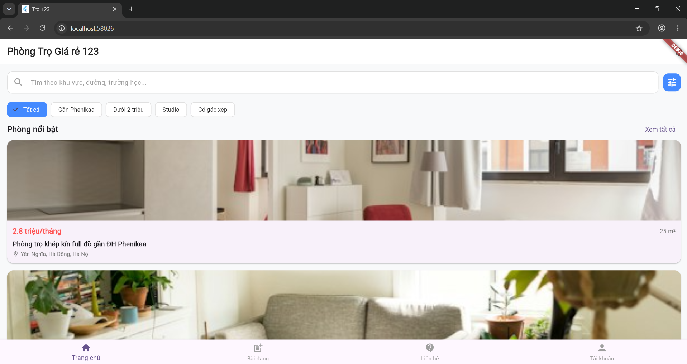

# Ứng Dụng Quản Lý & Tìm Kiếm Phòng Trọ

Hệ thống hỗ trợ tìm kiếm, quản lý bài đăng và kết nối thuê phòng trọ, được phát triển trên nền tảng Flutter theo kiến trúc Feature-First.

---

## Phân Chia Module & Trách Nhiệm

Dự án áp dụng mô hình Feature-First. Mỗi thành viên chịu trách nhiệm độc lập trên một module tương ứng trong thư mục `lib/features/`:

| Module           | Đường dẫn thư mục            | Chức năng chính                                                      | Người phụ trách   |
| :--------------- | :--------------------------- | :------------------------------------------------------------------- | :---------------- |
| **Auth**         | `lib/features/auth/`         | Đăng nhập (email, Google), phân quyền (Admin / Chủ trọ / Khách thuê) | Le Thi Phuong Anh |
| **Home Catalog** | `lib/features/home_catalog/` | Khám phá, tìm kiếm, bộ lọc & gợi ý phòng trọ                         | Tên Thành Viên 2  |
| **Manage Posts** | `lib/features/manage_posts/` | Tạo, chỉnh sửa, xóa và quản lý trạng thái tin đăng                   | Tên Thành Viên 3  |
| **Contact**      | `lib/features/contact/`      | Liên hệ trực tiếp, nhắn tin & đặt lịch hẹn xem phòng                 | Lê Hải Anh        |

---

## Cấu Trúc Thư Mục Chuẩn

```text
lib/
├── core/                  # Cấu hình dùng chung (Network, Theme, Constants, Widgets dùng chung)
│   ├── base/              # BaseEntity<ID>, EntityRegistry, Repository<T> (Generics dùng chung)
│   ├── routes/            # Cấu hình App Route chung
│   └── main_screen.dart   # Shell điều hướng chính (BottomNavigationBar)
├── features/              # Chia theo module tính năng độc lập
│   ├── auth/
│   │   ├── data/          # AuthService (đăng nhập, phân quyền), FirestoreRepository<T> (class generic dùng chung)
│   │   ├── models/        # AppUser, UserRole
│   │   ├── screens/       # Đăng nhập, đăng ký, quên mật khẩu, tài khoản, quản lý người dùng
│   │   ├── utils/         # Validators
│   │   └── widgets/       # RoleGuard, ô nhập, nút dùng chung
│   ├── contact/
│   ├── home_catalog/
│   └── manage_posts/
├── main.dart              # Entry point của ứng dụng
└── routers.dart
```

---

## Đối Tượng Generics Dùng Chung (Generics & Kế Thừa)

### Câu 1 – `BaseEntity<ID>` (`lib/core/base/`)

Mọi đối tượng dữ liệu của dự án (phòng, liên hệ, lịch hẹn, đánh giá, báo cáo, ...) đều có chung id, ngày tạo, cách chuyển sang JSON và cách so sánh. Thay vì mỗi module tự viết lại, nhóm dùng một lớp generic duy nhất:

```dart
abstract class BaseEntity<ID extends Object> {
  final ID id;                  // kiểu khóa chính do lớp con quyết định (String, int, ...)
  final DateTime? createdAt;
  const BaseEntity({required this.id, this.createdAt});
  Map<String, dynamic> toJson();   // lớp con tự cài đặt
}
```

| File                   | Vai trò                                                                                         |
| :--------------------- | :---------------------------------------------------------------------------------------------- |
| `base_entity.dart`     | `BaseEntity<ID>`: id, createdAt, `toJson()`, ghi đè `==`, `hashCode`, `toString`                |
| `entity_registry.dart` | `EntityRegistry`: đăng ký "kiểu `T` → cách dựng từ JSON + tên bảng", dùng `Type`                |
| `repository.dart`      | `Repository<T extends BaseEntity<String>>`: CRUD tổng quát (thêm, tìm, sửa, xóa, xuất/nạp JSON) |

### Câu 2 – Kế thừa và tổng quát hóa

| Đối tượng     | Kế thừa              | Vị trí                                        | Ghi chú                                                     |
| :------------ | :------------------- | :-------------------------------------------- | :---------------------------------------------------------- |
| `RoomItem`    | `BaseEntity<String>` | `features/home_catalog/models/room_item.dart` | Đối tượng có sẵn, trước đây nằm trong `counter_screen.dart` |
| `Contact`     | `BaseEntity<String>` | `features/contact/models/contact.dart`        | Tin nhắn liên hệ chủ trọ                                    |
| `Appointment` | `BaseEntity<String>` | `features/contact/models/appointment.dart`    | Lịch hẹn, có luồng trạng thái                               |
| `Review`      | `BaseEntity<String>` | `features/contact/models/review.dart`         | Đánh giá 1-5 sao, `RatingSummary`                           |
| `Report`      | `BaseEntity<String>` | `features/contact/models/report.dart`         | Báo cáo vi phạm cho admin xử lý                             |

**Dùng `Object` class (dart:core)** – `BaseEntity` ghi đè các thành viên của `Object`:

- `==` và `hashCode`: hai đối tượng **cùng kiểu và cùng id** là bằng nhau (không so sánh từng trường).
- `toString()`: in `TênLớp({json})` để debug.
- `runtimeType`: cho biết lớp thật của đối tượng lúc chạy (vd `Contact`, `Review`).

**Dùng "Class class"** – trong Dart, đối tượng mô tả một lớp lúc chạy là `Type` (lấy bằng `runtimeType` hoặc viết `T` trong hàm generic). `EntityRegistry` dùng `Type` làm khóa nên code chung viết được như sau, không cần chuỗi `if (T == Contact) ... else if (T == Review) ...`:

```dart
T clone<T extends BaseEntity>(T e) => EntityRegistry.fromJson<T>(e.toJson());
```

> Lưu ý: `Class` trong thư viện `vm_service` (link trong đề bài) là API mô tả lớp thông qua VM Service, dùng cho công cụ debug và cần kết nối tới Dart VM đang chạy. Nó không dùng được trong app Flutter thông thường, nên nhóm dùng `Type`/`runtimeType` làm phần tương ứng.

### Quy ước cho cả nhóm

1. Model mới viết là `class Xxx extends BaseEntity<String>`, cài đặt `toJson()` (gộp `...baseJson()`) và `factory Xxx.fromJson(...)`.
2. Viết hàm `registerXxxModels()` gọi `EntityRegistry.register<Xxx>(Xxx.fromJson, name: '...')`. Hiện có `registerRoomModels()` và `registerContactModels()`. Cần thêm lời gọi vào `main()` khi chạy app (theo quy tắc phía dưới thì phải thống nhất với nhóm trước khi sửa `main.dart`).
3. Lưu và truy vấn dữ liệu qua `Repository<T>`, không tự viết lại danh sách + hàm CRUD trong từng module.
4. Id của các đối tượng là `String` (giống `RoomItem.id`); các trường tham chiếu như `roomId`, `ownerId` cũng là `String`.

### Chạy thử

```bash
flutter pub get
flutter test test/generics_test.dart      # kiểm tra tự động
dart run tool/demo_generics.dart          # in kết quả demo ra màn hình
```

### Ảnh chụp màn hình kết quả


[!IMPORTANT]

### Lưu Ý Quan Trọng

1. Tuyệt đối không tự ý chỉnh sửa `lib/main.dart` và `lib/core/routes/`. Mọi thay đổi cấu hình toàn cục phải thảo luận trước với cả nhóm.
2. Test code chạy được trước khi push
3. Nên kiểm tra và pull code mới nhất (nếu có) trước khi bắt đầu code :D

---

## Cài Đặt & Chạy Dự Án

Dự án dùng **Firebase** (project `phongtroproject-77ddf`): Authentication để đăng nhập, Firestore để lưu dữ liệu.
Các file cấu hình `lib/firebase_options.dart`, `android/app/google-services.json` đã có sẵn trong dự án, **không cần chạy lại `flutterfire configure`**.

### Lần đầu

1. Bật **Developer Mode** trên Windows (bắt buộc để build plugin): chạy `start ms-settings:developers` → bật _Developer Mode_.
2. Cài thư viện:
   ```powershell
   flutter pub get
   ```
3. Chạy trên Chrome:
   ```powershell
   flutter run -d chrome
   ```

### Chạy trên Android // khong can thiet lam vi ca nhom deu chay tren chrome

- Nếu gặp lỗi _"An Application Control policy has blocked this file"_: tắt **Smart App Control** (Windows Security → App & browser control → Smart App Control settings → Off).
- **Đăng nhập Google trên Android** cần đăng ký mã SHA-1 của **từng máy**:
  1. Chạy app trên máy ảo ít nhất 1 lần.
  2. Lấy SHA-1:
     ```powershell
     & "C:\Program Files\Android\Android Studio\jbr\bin\keytool.exe" -list -v -alias androiddebugkey -keystore "$env:USERPROFILE\.android\debug.keystore" -storepass android -keypass android
     ```
  3. Gửi dòng `SHA1: ...` cho người quản lý Firebase để thêm vào _Project settings → Your apps → Android → Add fingerprint_.

### Quyền truy cập Firebase Console

Nhờ người quản lý thêm email của bạn vào _Project settings → Users and permissions_ để xem dữ liệu và deploy rules.

---

## Firebase

### Dữ liệu

| Collection      | Module | Nội dung                                                                                                      |
| :-------------- | :----- | :------------------------------------------------------------------------------------------------------------ |
| `users/{uid}`   | Auth   | `fullName`, `email`, `phone` (có thể null), `role` (`admin` / `landlord` / `tenant`), `disabled`, `createdAt` |
| `avatars/{uid}` | Auth   | `data` (ảnh đại diện dạng Base64, đã nén 256px), `updatedAt`                                                  |

Khi tạo collection mới, hãy bổ sung vào bảng này.

### Firestore Rules

Rules nằm trong file [`firestore.rules`](firestore.rules). **Không sửa rules trực tiếp trên Firebase Console** (sẽ bị ghi đè ở lần deploy sau).

Cập nhật rules:

1. Sửa file `firestore.rules`.
2. Deploy (cần cài `npm install -g firebase-tools` và `firebase login` trước):
   ```powershell
   firebase deploy --only firestore:rules
   ```
   Nếu sai cú pháp, lệnh sẽ báo lỗi kèm số dòng và **không** đẩy lên.

Hiện tại các collection ngoài `users` dùng quy tắc tạm: **ai cũng đọc được, tài khoản đã đăng nhập (không bị khóa) mới ghi được**. Khi làm module của mình, hãy thêm rules riêng phía trên đoạn _"Tạm thời cho các module khác"_ và loại collection đó khỏi quy tắc tạm, ví dụ cho bài đăng:

```
match /posts/{postId} {
  allow read: if true;
  allow create: if isActive() && myProfile().role == 'landlord'
    && request.resource.data.ownerId == request.auth.uid;
  allow update, delete: if isActive()
    && (resource.data.ownerId == request.auth.uid || isAdmin());
}

match /{collection}/{document=**} {
  allow read: if collection != 'users' && collection != 'posts';
  allow write: if collection != 'users' && collection != 'posts' && isActive();
}
```

Các hàm có sẵn trong rules: `signedIn()`, `isAdmin()`, `isActive()` (đăng nhập và không bị khóa), `myProfile()` (hồ sơ của người đang gọi).

---

## Hướng Dẫn Dùng Module Auth (cho các module khác)

Mọi thứ đi qua `AuthService.instance`. Import:

```dart
import 'package:flutter_application_test/features/auth/data/auth_service.dart';
import 'package:flutter_application_test/features/auth/models/app_user.dart';
import 'package:flutter_application_test/features/auth/widgets/role_guard.dart';
import 'package:flutter_application_test/features/auth/screens/login_screen.dart';
```

### Vai trò

| `UserRole`          | Hiển thị      | Cách có                                                                                                                          |
| :------------------ | :------------ | :------------------------------------------------------------------------------------------------------------------------------- |
| `UserRole.tenant`   | Khách thuê    | Tự chọn khi đăng ký                                                                                                              |
| `UserRole.landlord` | Chủ trọ       | Tự chọn khi đăng ký                                                                                                              |
| `UserRole.admin`    | Quản trị viên | Admin khác cấp trong _Tài khoản → Quản lý người dùng_. Admin đầu tiên: sửa `role` thành `admin` trực tiếp trên Firestore Console |

### Lấy người dùng đang đăng nhập

```dart
final AppUser? user = AuthService.instance.currentUser.value; // null = chưa đăng nhập

user?.id;          // uid, dùng làm ownerId / senderId khi lưu dữ liệu
user?.fullName;
user?.email;
user?.phone;       // có thể null
user?.role;        // UserRole
user?.isAdmin;     // cũng có isLandlord, isTenant
user?.hasAnyRole([UserRole.landlord, UserRole.admin]);
```

### Giao diện tự cập nhật khi đăng nhập / đăng xuất / đổi vai trò

```dart
ValueListenableBuilder<AppUser?>(
  valueListenable: AuthService.instance.currentUser,
  builder: (context, user, _) {
    if (user?.isLandlord == true) {
      return const Text('Nút Đăng tin chỉ chủ trọ thấy');
    }
    return const SizedBox.shrink();
  },
)
```

### Chặn cả màn hình theo vai trò: `RoleGuard`

```dart
// Chỉ chủ trọ và admin vào được
RoleGuard(
  allowed: [UserRole.landlord, UserRole.admin],
  child: ManagePostsScreen(),
)

// Chỉ cần đăng nhập, vai trò nào cũng được
RoleGuard(child: ChatScreen())
```

Chưa đăng nhập → hiện nút Đăng nhập. Sai vai trò → hiện "Bạn không có quyền truy cập".

### Yêu cầu đăng nhập trước một hành động (ví dụ bấm "Liên hệ")

```dart
void _onContactPressed() {
  final user = AuthService.instance.currentUser.value;
  if (user == null) {
    Navigator.of(context).push(
      MaterialPageRoute(builder: (_) => const LoginScreen()),
    );
    return;
  }
  // ... xử lý liên hệ với user.id
}
```

### Đọc / ghi Firestore bằng class generic `FirestoreRepository<T>`

`FirestoreRepository<T>` mô tả chung "một collection Firestore chứa các đối tượng kiểu `T`". Module Auth đang dùng nó cho `users` (`T = AppUser`) và `avatars` (`T = Avatar`). Các module khác có thể dùng lại cho bài đăng, tin nhắn..., chỉ cần model có `fromMap` và `toMap`:

```dart
import 'package:flutter_application_test/features/auth/data/firestore_repository.dart';

final postRepo = FirestoreRepository<Post>(
  collectionPath: 'posts',
  fromMap: Post.fromMap,                 // Post.fromMap(String id, Map<String, dynamic> data)
  toMap: (post) => post.toMap(),
);

final Post? post = await postRepo.get(postId);                       // đọc 1 bài
postRepo.watchAll(orderBy: 'createdAt', descending: true);           // Stream<List<Post>>
await postRepo.set(postId, post, extraFields: {'createdAt': FieldValue.serverTimestamp()});
await postRepo.update(postId, {'status': 'rented'});                  // sửa 1 vài trường
await postRepo.delete(postId);
```

### Hiển thị ảnh đại diện

```dart
import 'package:flutter_application_test/features/auth/widgets/user_avt.dart';

UserAvatar(user: user, radius: 20)   // tự hiện ảnh, chưa có ảnh thì hiện chữ cái đầu
```

### Lưu ý

- **Luôn kiểm tra quyền ở cả hai nơi:** trong app (RoleGuard / `user.role`) để ẩn giao diện, và trong `firestore.rules` để chặn thật. Kiểm tra trong app có thể bị vượt qua.
- Admin có thể **khóa tài khoản** (`disabled = true`): người bị khóa tự bị đăng xuất, không đăng nhập lại được và không ghi được dữ liệu.
- Không gọi trực tiếp `FirebaseAuth.instance` trong module khác, hãy dùng `AuthService` để trạng thái đăng nhập luôn đồng bộ.

## Giao diện demo ứng dụng


