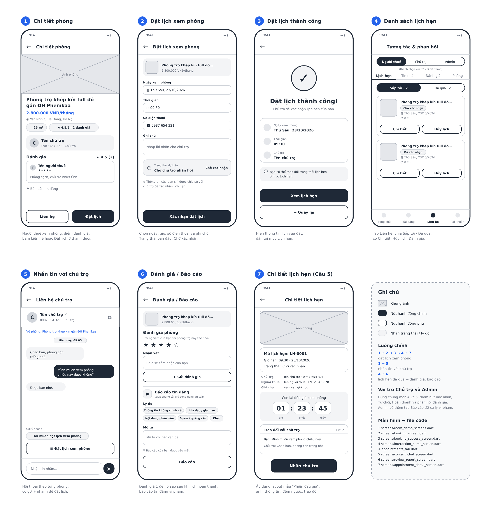

# Module Tương tác & phản hồi người dùng (`lib/features/contact/`)

Gồm 4 chức năng xoay quanh việc người thuê làm việc với chủ trọ và với hệ thống:
**liên hệ (nhắn tin)**, **đặt lịch hẹn xem phòng**, **đánh giá phòng**, **báo cáo vi phạm**.

> Tên thư mục vẫn là `contact` để không ảnh hưởng đường dẫn import của các module khác. Tên hiển thị của module là "Tương tác & phản hồi người dùng".

Người thực hiện: Lê Hải Anh (MSSV 24100110).

## Chức năng theo vai trò

| Vai trò        | Làm được gì                                                                                                                                                                                    |
| :------------- | :--------------------------------------------------------------------------------------------------------------------------------------------------------------------------------------------- |
| **Người thuê** | Nhắn tin cho chủ trọ về một phòng · đặt lịch xem phòng · xem / hủy lịch hẹn · đánh giá phòng sau khi lịch hẹn hoàn thành · sửa, xóa đánh giá của mình · báo cáo bài đăng, người dùng, đánh giá |
| **Chủ trọ**    | Xem và trả lời tin nhắn (có đếm tin chưa xem) · xác nhận / từ chối (có lý do) / hoàn thành lịch hẹn · phản hồi đánh giá về phòng của mình                                                      |
| **Admin**      | Xem báo cáo chờ xử lý / đã xử lý · bỏ qua hoặc xác nhận vi phạm (ẩn bài, khóa tài khoản, xóa đánh giá) · xóa đánh giá                                                                          |

Vai trò lấy từ tài khoản đăng nhập (module Đăng nhập): Khách thuê → Người thuê, Chủ trọ → Chủ trọ, Quản trị viên → Admin.

## Luật nghiệp vụ (đã có test)

- Lịch hẹn: `pending → confirmed → completed`, hoặc `pending → rejected`, hoặc `pending/confirmed → cancelled`.
- Chỉ nhận lịch từ 07:00 đến 21:00, không đặt giờ đã qua, bắt buộc có số điện thoại.
- Cùng một phòng không có hai lịch cách nhau dưới 1 giờ (với lịch đã xác nhận; người thuê cũng không tự đặt hai lịch sát giờ).
- Chỉ đánh giá được sau khi lịch hẹn **đã hoàn thành**, từ 1 đến 5 sao, mỗi lịch hẹn một đánh giá.
- Báo cáo: không gửi trùng khi báo cáo cũ của mình còn chờ xử lý; mỗi báo cáo chỉ xử lý một lần.
- Tài khoản bị khóa thì không nhắn tin, đặt lịch, đánh giá, báo cáo được nữa.
- Tin nhắn dài 1–500 ký tự; chỉ người thuê và chủ trọ của cuộc trò chuyện mới nhắn được.

## Cấu trúc

```text
lib/features/contact/
├── models/      contact.dart, contact_message.dart, appointment.dart, review.dart, report.dart
│                (mỗi model extends BaseEntity<String>; contact_models.dart gom + registerContactModels())
├── services/    interaction_service.dart   # toàn bộ nghiệp vụ, lưu bằng Repository<T>
│                contact_firebase.dart      # nối với Firebase: người dùng thật, Firestore, phòng thật
├── widgets/     thành phần dùng lại: thẻ lịch hẹn, form đánh giá/báo cáo, nút hành động ở trang chi tiết phòng...
└── screens/     đặt lịch, đặt lịch thành công, đánh giá/báo cáo, chat, chi tiết lịch hẹn, các tab và màn hình chính
```

Màn hình chính của module: `InteractionHomeScreen` (đổi giao diện theo vai trò: người thuê 4 tab, chủ trọ 3 tab, admin 2 tab).

## Wireframe



Gồm 7 màn hình chính của module và khung ghi chú (luồng chính, vai trò, file code tương ứng). File vector gốc: [`assets/lien_he_wireframe.svg`](../../../assets/lien_he_wireframe.svg).

Màn 4 vẽ thanh chọn vai trò của chế độ demo. Khi chạy dữ liệu thật, thanh này được thay bằng dòng "Đang đăng nhập: tên · vai trò".

## Dữ liệu và Firebase

`InteractionService` giữ dữ liệu trong `Repository<T>` (dùng chung của nhóm). Có 2 chế độ:

- **Dữ liệu thật** (khi chạy app): `main.dart` gọi `ContactFirebase.instance.attach()` một lần sau `Firebase.initializeApp`. Từ đó:
  - người dùng hiện tại = tài khoản đang đăng nhập (`AuthService.instance.currentUser`), đổi tài khoản thì dữ liệu đổi theo;
  - mọi thay đổi của `Repository` (thêm / sửa / xóa) tự được ghi lên Firestore, và dữ liệu từ Firestore đổ về theo thời gian thực (2 người dùng 2 máy thấy nhau ngay);
  - danh sách phòng lấy từ bài đăng đã duyệt và không ẩn của module Quản lý bài đăng (collection `posts`, chỉ đọc);
  - admin xác nhận báo cáo người dùng thì tài khoản đó bị khóa thật (`users/{id}.disabled = true`, qua `AuthService.setDisabled`).
- **Dữ liệu giả** (`isDemo == true`, mặc định khi tạo `InteractionService()` trong test): có thanh chọn vai trò ở đầu màn hình để xem 3 giao diện. Toàn bộ test chạy ở chế độ này nên không cần mạng.

Các collection module dùng:

| Collection         | Nội dung                                              | Ai được lấy về trong app                          |
| :----------------- | :---------------------------------------------------- | :------------------------------------------------ |
| `contacts`         | cuộc trò chuyện (kèm danh sách tin nhắn)              | người thuê và chủ trọ của cuộc đó                 |
| `appointments`     | lịch hẹn                                              | người thuê và chủ trọ của lịch; admin xem tất cả  |
| `reviews`          | đánh giá                                              | mọi người (hiện điểm trung bình của phòng)        |
| `reports`          | báo cáo vi phạm                                       | người gửi; admin xem tất cả                       |
| `contact_profiles` | "danh thiếp" (tên, vai trò; số điện thoại chỉ của chủ trọ) | mọi người, để hiện tên trong chat, đánh giá |

Hồ sơ `users` của người khác không đọc được (theo `firestore.rules`), nên mỗi người đăng danh thiếp của mình vào `contact_profiles` khi đăng nhập.

**Về `firestore.rules`:** module không sửa file này. Các collection trên đang dùng luật chung của nhóm ("ai cũng đọc được, đăng nhập và không bị khóa mới ghi được"), nên việc ai xem được gì hiện chỉ do app lọc. Muốn chặt hơn cần viết luật riêng cho từng collection và deploy bằng `firebase deploy --only firestore:rules`.

## Gắn vào ứng dụng

**1. `main.dart`** – bật dữ liệu thật (đã làm):

```dart
await Firebase.initializeApp(options: DefaultFirebaseOptions.currentPlatform);
ContactFirebase.instance.attach();
```

**2. Tab "Liên Hệ" của `MainScreen`** (`lib/core/main_screen.dart`) – đã gắn, có chặn đăng nhập bằng `RoleGuard`:

```dart
RoleGuard(child: InteractionHomeScreen()),
```

**3. Trang chi tiết phòng** (người ghép trang chủ / chi tiết phòng) – chỉ cần truyền `roomId`. Các nút tự hỏi đăng nhập khi chưa đăng nhập (`requireLogin`):

```dart
import '../../contact/widgets/room_actions.dart';

ReviewList(roomId: room.id)        // điểm trung bình + danh sách đánh giá của phòng
ReportButton(roomId: room.id)      // nút "Báo cáo" bài đăng
RoomActionBar(roomId: room.id)     // thanh dưới cùng: Liên hệ + Đặt lịch
// hoặc lẻ từng nút: ContactButton(roomId: ...), BookingButton(roomId: ...)
```

`roomId` là id của bài đăng trong collection `posts`.

**4. Điểm đánh giá cho trang chủ / tìm kiếm / gợi ý:**

```dart
final r = InteractionService.instance.ratingSummary(room.id);
// r.average (0.0 nếu chưa có), r.count
```

Ví dụ hoàn chỉnh xem `screens/room_demo_screens.dart` (tab "Phòng" của người thuê, dùng để thử luồng).

## Màn hình theo layout mẫu của giáo viên (Câu 5)

Màn **Chi tiết lịch hẹn** (`screens/appointment_detail_screen.dart`) áp dụng layout mẫu "Phiên đấu giá":
ảnh phòng ở trên cùng, khối thông tin chính, đồng hồ đếm ngược tới giờ hẹn, lịch sử tin nhắn và nút hành động dạng viên thuốc.

Cách mở: tab **Liên hệ** > tab **Lịch hẹn** > bấm **Chi tiết** ở một thẻ lịch hẹn.

Các widget con của màn này nằm trong `widgets/`: `room_image_box.dart`, `appointment_info_card.dart`, `countdown_timer_box.dart`, `message_history_box.dart`, `pill_action_button.dart`.

## Chạy thử và kiểm tra

```bash
flutter pub get
flutter test test/interaction_service_test.dart   # nghiệp vụ (không cần giao diện)
flutter test test/interaction_ui_test.dart        # các luồng giao diện chính
flutter test test/repository_hooks_test.dart      # phần nối Firebase (không cần mạng)
flutter test                                      # toàn bộ test, gồm cả test Generics
flutter run -d chrome
```

Thử 2 tài khoản cùng lúc: chạy `flutter run -d chrome`, mở thêm một cửa sổ ẩn danh vào cùng địa chỉ `localhost:<cổng>`, đăng nhập mỗi cửa sổ một tài khoản (ví dụ khách thuê và chủ trọ của phòng đó).

## Hạn chế và hướng phát triển

- **Mất tin khi gửi đồng thời:** mỗi cuộc trò chuyện là một document nên hai người gửi tin cùng một khoảnh khắc có thể ghi đè tin của nhau. Cách khắc phục: lưu tin nhắn ở subcollection.
- **Kiểm tra trùng giờ đặt lịch:** người thuê chỉ thấy lịch của chính mình (để không lộ thông tin người khác), nên trùng giờ với lịch của người khác được chặn khi chủ trọ bấm Xác nhận.
- **Ẩn bài khi báo cáo được xác nhận:** chỉ ẩn trong danh sách phòng của module, vì luật của bài đăng chỉ cho chủ bài đổi `isHidden`.
- **Ảnh phòng dạng base64** (`data:image/jpeg;base64,...`) hiện hiển thị bằng `Image.network`, chạy tốt trên web, cần kiểm tra thêm trên Android / iOS.
- **Luật Firestore riêng** cho các collection của module (xem mục "Dữ liệu và Firebase").
- **Thông báo đẩy** khi có lịch hẹn hoặc tin nhắn mới.